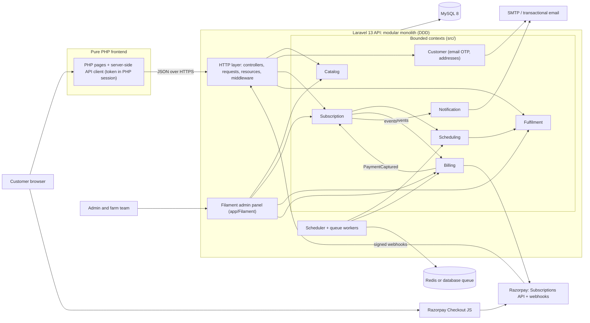
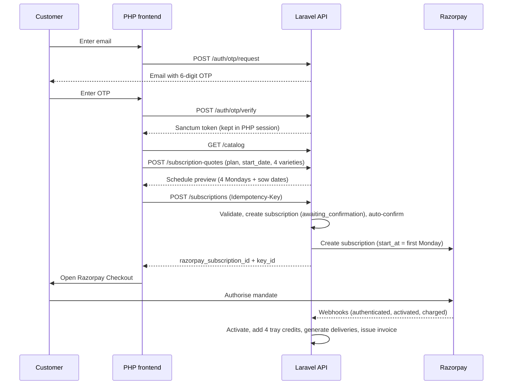

# Nirmal Greens: Backend Plan

Laravel 13 · Domain-Driven Design · Razorpay · Email OTP · Pure PHP frontend

---

## 1. Project summary

Nirmal Greens is a Bengaluru microgreens subscription business.

- **6 varieties**, each with a fixed harvest (grow) time.
- **3 plans** (50 g, 100 g, 200 g). Each gives **4 trays a month, one every Monday**.
- The customer picks 4 varieties (one per Monday) and a start date.
- Trays are **harvested live at the customer's door**, so each variety is sown *grow-days* before its delivery Monday.
- Payment is a monthly Razorpay subscription (UPI autopay or card). **Nothing is charged until the first Monday is confirmed.**
- Frontend: already built in pure PHP, calling this API server-side.
- Login: **email OTP** (no paid SMS or WhatsApp API).

### Facts taken from the client files

| Item | Value |
|---|---|
| Plans | 50 g ₹1,499 · 100 g ₹2,499 · 200 g ₹3,499 (per month, 4 trays) |
| Plan names in profile docx | Nirmal Basics / Health / Personalized |
| Varieties and harvest days | Broccoli 10 · Fenugreek 8 · Pink Radish 9 · Mustard 9 · Sunflower 12 · Radish 8 |
| Edit window | Skip or swap allowed until **Saturday 9 PM** before the Monday |
| Pause rule | A paused week is added to the end of the cycle, never lost |
| Delivery tracking steps | Confirmed → tray selected (rack) → loaded on van → out for doorstep harvest → handed over |
| Slots | Standard 6–10 AM · Priority 6–8 AM (100 g) · Choice of window (200 g) |

### Items to confirm with the client

1. **Spinach vs Radish.** The docx lists Spinach, but the UI lists Radish. The plan follows the UI. Varieties are DB-driven, so changing is one row.
2. **Repeats.** Only the 100 g card says "repeats allowed", but the picker allows repeats on every plan.
3. **Swap vs sowing.** A tray is sown 8–12 days before delivery, but swaps are allowed until Saturday. Swaps are only possible if spare trays exist (see `tray_batches`).
4. **Email OTP changes client copy.** The site currently says "No password, no email needed" and "The number is your login".

---

## 2. System architecture



### Bounded contexts

| Context | Responsibility |
|---|---|
| **Catalog** | Plans, plan features, varieties (grow days, content) |
| **Customer** | Email OTP login, profile, addresses, serviceable pincodes, waitlist |
| **Subscription** | Lifecycle, variety selection, skip, swap, cancel |
| **Scheduling** | Builds the 4 Mondays, computes sow dates, cutoff and lock policy |
| **Fulfilment** | Tray batches, production (sowing) plan, delivery status, routes |
| **Billing** | Razorpay subscription, payments, invoices, webhooks, one-time orders |
| **Notification** | Email reminders and receipts (WhatsApp via free `wa.me` link) |

Contexts talk through **domain events**, not by reaching into each other's tables.

### Subscribe flow



---

## 3. Scheduling logic (core requirement)

**Input from the frontend:** `plan`, `start_date`, `varieties[4]` (in delivery order).

```php
// Domain service: ScheduleBuilder
$deliveries = [];
foreach ($varieties as $i => $variety) {
    $deliveryDate = $startDate->addWeeks($i);                  // must be a Monday (IST)
    $sowDate      = $deliveryDate->subDays($variety->growDays);
    $lockAt       = $deliveryDate->subDays(2)->setTime(21, 0); // Saturday 9 PM IST

    if ($sowDate->lt(today('Asia/Kolkata')->addDay())) {
        throw new StartDateTooEarly($variety, $sowDate);
    }
    $deliveries[] = new Delivery($deliveryDate, $variety, $sowDate, $lockAt);
}
```

**Validation rules**

- `start_date` must be a Monday and the address must be serviceable.
- Every tray's `sow_date` must be at least tomorrow. The earliest start therefore depends on the variety (Sunflower needs 12 days of lead time, Radish 8).
- Selection rules come from `plans.rules` (4 trays, repeats allowed or not, split trays).

**Worked example** (today Wed 14 Oct 2026, start Mon 2 Nov)

| Monday | Variety | Grow days | Sow date | Edit lock |
|---|---|---|---|---|
| 2 Nov | Broccoli | 10 | 23 Oct | Sat 31 Oct, 9 PM |
| 9 Nov | Mustard | 9 | 31 Oct | Sat 7 Nov, 9 PM |
| 16 Nov | Sunflower | 12 | 4 Nov | Sat 14 Nov, 9 PM |
| 23 Nov | Radish | 8 | 15 Nov | Sat 21 Nov, 9 PM |

**Skip or pause:** the delivery becomes `skipped`, no tray credit is used, and a new delivery is appended at the end of the schedule.
**Tray credits:** each successful Razorpay charge adds 4 credits and each delivered Monday uses 1. This handles 5-Monday months and skips cleanly.
**Next cycle:** after each `subscription.charged`, 4 more deliveries are generated. They default to the last selection and stay editable until lock.
**Sowing list:** group non-skipped deliveries by `sow_date` and variety, and count trays.

---

## 4. Razorpay integration

- Create **3 Razorpay Plans** (monthly) and store each `razorpay_plan_id` on `plans`.
- Create the subscription with `start_at` = first Monday, matching "nothing is charged until confirmed". *Verify current `start_at` and UPI autopay behaviour in Razorpay's docs.*
- Verify the Checkout signature, but treat **webhooks as the source of truth**.
- Webhook: verify `X-Razorpay-Signature` on the **raw body**, dedupe on event id, queue the job, return 200 fast.

| Event | Reaction |
|---|---|
| `subscription.authenticated` | Mandate set up, still pending |
| `subscription.activated` | Activate subscription |
| `subscription.charged` | Record payment, add 4 credits, generate deliveries, issue invoice |
| `payment.failed` | Mark `past_due`, email customer |
| `subscription.pending` / `halted` | Pause deliveries |
| `subscription.paused` / `resumed` / `cancelled` | Sync status |
| `subscription.completed` | Mark completed |

One-time orders and the 200 g "Thursday top-up at cost" use the **Orders** API.

---

## 5. Database architecture

```
customers            id, name, email (unique), email_verified_at, phone
customer_addresses   id, customer_id, line1, area, pincode, cluster_id, is_default
delivery_clusters    id, name, is_active
serviceable_pincodes pincode (pk), cluster_id, is_active
waitlist_entries     id, email, phone, pincode, area

otp_codes            id, identifier (email), code_hash, expires_at, attempts, consumed_at

plans                id, code, name, weight_g, price_paise, trays_per_cycle,
                     rules json (allow_repeats, priority_slot, free_swap,
                     split_trays, choose_window), razorpay_plan_id, is_active
plan_features        id, plan_id, label, sort
varieties            id, slug, name, latin, grow_days, yield_min_g, yield_max_g,
                     tag, is_active, content json (timeline, health, eat, caution)

subscriptions        id (uuid), customer_id, plan_id, address_id, status, start_date,
                     tray_credits, razorpay_subscription_id, cancelled_at, created_at
subscription_cycles  id, subscription_id, cycle_no, charged_payment_id, started_at
deliveries           id, subscription_id, cycle_id, sequence_no, delivery_date,
                     variety_id, sow_date, lock_at, locked_at, status,
                     slot (priority|standard|window), harvest_window,
                     tray_batch_id, delivered_at, skip_reason

tray_batches         id, variety_id, sow_date, ready_date, trays_total, trays_reserved
production_days      (view) sow_date, variety_id, trays_needed

payments             id, subscription_id, razorpay_payment_id (unique), amount_paise,
                     status, method, captured_at
invoices             id, payment_id, number, pdf_path
one_time_orders      id, customer_id, razorpay_order_id, items json, amount_paise, status
webhook_events       id, provider_event_id (unique), type, payload json, processed_at
support_tickets      id, customer_id, topic, message, status
notification_logs    id, customer_id, channel, template, status
audit_logs           id, actor, action, subject, meta json
```

**Status enums**

- Subscription: `awaiting_confirmation`, `confirmed`, `active`, `paused`, `past_due`, `cancelled`, `completed`
- Delivery: `scheduled`, `locked`, `tray_assigned`, `loaded`, `out_for_delivery`, `delivered`, `skipped`, `failed`

**Indexes:** `deliveries(delivery_date, status)`, `deliveries(sow_date, variety_id)`, `deliveries(subscription_id, sequence_no)`, `customers(email)`.
Store money as integer **paise**. Store times in UTC and compute cutoffs and dates in `Asia/Kolkata`.

---

## 6. Folder architecture

Add `"Src\\": "src/"` to the PSR-4 autoload in `composer.json` (classes live in namespaces like `Src\Catalog\Domain`), then run `composer dump-autoload`.

```
src/
├── Shared/
│   ├── Domain/            AggregateRoot, DomainEvent, Money, IstClock
│   └── Infrastructure/
├── Catalog/
│   ├── Domain/            Plan, Variety, PlanRules
│   ├── Application/
│   └── Infrastructure/
├── Customer/
│   ├── Domain/            Customer, Address, Otp
│   └── Application/       RequestOtp, VerifyOtp, SaveAddress
├── Subscription/
│   ├── Domain/            Subscription, VarietySelection, SubscriptionStatus, Events/, Exceptions/
│   ├── Application/       StartSubscription, SkipDelivery, SwapVariety, CancelSubscription
│   └── Infrastructure/
├── Scheduling/
│   ├── Domain/            ScheduleBuilder, CutoffPolicy, EarliestStartPolicy, Delivery
│   └── Application/       QuoteSchedule, GenerateCycleDeliveries, LockDeliveries
├── Fulfilment/
│   ├── Domain/            TrayBatch, DeliveryStatus
│   └── Application/       ProductionPlan, AssignTray, MarkDelivered
├── Billing/
│   ├── Domain/            Payment, PaymentGateway (interface), Invoice
│   ├── Application/       CreateRazorpaySubscription, VerifyCheckout, HandleWebhook, CreateTopUpOrder
│   └── Infrastructure/Razorpay/   RazorpayGateway, WebhookVerifier
└── Notification/
    ├── Application/       Event listeners
    └── Infrastructure/    Mail

app/
├── Http/Controllers/Api/V1/   Auth, Catalog, Quote, Subscription, Delivery, Webhook, Admin
├── Http/Requests/
├── Http/Resources/
├── Http/Middleware/
├── Filament/                  Admin panel: Resources, Pages, Widgets
├── Console/                   Schedule definitions
└── Providers/                 Bind interfaces to implementations

database/   migrations, seeders (plans, 6 varieties, pincodes)
tests/      Unit/Domain, Feature/Api, Integration/Razorpay
```

**Rules**

- `src/*/Domain` has no Laravel or Eloquent imports.
- Application = one handler per use case. Infrastructure = Eloquent repositories and the Razorpay SDK.
- Controllers are thin: validate, call a handler, return a Resource.
- One handler = one DB transaction. Dispatch domain events after commit.

---

## 7. API surface (v1)

```
POST /auth/otp/request | /auth/otp/verify
GET  /catalog                         plans, varieties, earliest_start per variety
GET  /serviceability?pincode=
POST /subscription-quotes             plan, start_date, varieties[] → schedule preview
POST /subscriptions                   → razorpay_subscription_id + key_id (Idempotency-Key)
GET  /me/subscription                 schedule, status, tracking
POST /deliveries/{id}/skip | /swap | /resume
POST /subscriptions/{id}/cancel
POST /support/tickets
POST /webhooks/razorpay

Admin: handled by the Filament panel (no separate admin API needed)
```

---

## 8. Scheduled jobs (Asia/Kolkata)

| Job | When | Purpose |
|---|---|---|
| `LockDeliveries` | Sat 21:00 | Set `locked_at`, freeze edits |
| `GenerateProductionPlan` | Daily | Today's sowing list by variety |
| `SendMondayReminder` | Sun evening | Email slot and variety |
| `ReconcileRazorpay` | Daily | Catch missed webhooks |
| `ExpireOtps` | Hourly | Clean up |

---

## 9. Email OTP

- 6 digits, stored hashed (`Hash::make`), 10-minute expiry, single use.
- Max 5 wrong attempts per code, 60-second resend cooldown.
- Same response whether or not the email exists (no account enumeration).
- Never log the OTP.

```php
RateLimiter::for('otp-request', fn (Request $r) => [
    Limit::perMinute(1)->by('otp-min:'.strtolower($r->input('email'))),
    Limit::perHour(5)->by('otp-hour:'.strtolower($r->input('email'))),
]);
RateLimiter::for('otp-verify', fn (Request $r) =>
    Limit::perMinute(5)->by('otp-verify:'.strtolower($r->input('email'))));
```

> The PHP frontend makes the API calls, so `$request->ip()` is the frontend server. Rate limit mainly **by email**, forward the real client IP from the frontend (trusted only), and add per-IP throttling in the PHP layer or at the edge.

---

## 10. API security checklist

**Authentication**
- Sanctum personal access tokens with abilities (`customer`, `admin`) and an expiry (e.g. 7 days).
- The PHP frontend keeps the token in its **server-side session**. Never in JS, localStorage or HTML.
- Revoke old tokens on login, delete on logout. Admin uses a separate model or guard.

**Authorization**
- Scope every query through the logged-in user: `$request->user()->subscriptions()->where('uuid', $id)->firstOrFail()`.
- UUIDs for public IDs. Policies for skip, swap and cancel.

**Never trust the frontend**
- Price comes from the `plans` table. Dates come from `ScheduleBuilder`.
- Form Requests, `$request->validated()`, strict `$fillable`.
- `Idempotency-Key` on `POST /subscriptions`.
- Swap and skip in a transaction with `lockForUpdate()` on `tray_batches`.

**Razorpay**
- Webhook HMAC on the raw body with `hash_equals`, dedupe by event id.
- Verify the Checkout signature too (confirm exact format in Razorpay docs).
- Only `key_id` goes to the browser. Secrets stay in `.env`.

**Transport and headers**
- HTTPS only with HSTS, `APP_DEBUG=false`, generic JSON errors.
- CORS strict or empty (the browser never calls the API directly).
- `X-Content-Type-Options: nosniff`, `Referrer-Policy`. Optional shared `X-Client-Key` header from the PHP frontend plus IP allowlist.

**Data**
- Collect only what is needed (name, email, phone, address). Review India's DPDP Act for consent and retention.
- `audit_logs` for admin actions. Keep secrets, tokens and OTPs out of logs.

**Deployment**
- Document root = `public/`. `.env` not web-accessible. `config:cache`.
- `composer audit`, Dependabot, daily DB backups with a tested restore.
- Sentry plus failed-job and webhook-failure alerts. Cloudflare in front.

---

## 11. Hosting notes (low-cost plan)

1. **Email deliverability:** set up SPF, DKIM and DMARC. If OTPs hit spam or limits, plug a transactional email service into Laravel's mail config (`.env` change only).
2. **Laravel 13 requirements:** confirm the host offers the required PHP version, SSH or Composer, and cron.
3. **Queues:** without Redis use the `database` driver. Cron every minute for `php artisan schedule:run`, plus `queue:work --stop-when-empty`.
4. **Webhooks:** need a reliable HTTPS endpoint. A small VPS can beat a cheap shared plan, since the lock job and webhooks are time-sensitive.

---

## 12. Admin panel (Filament)

Decision: the admin is built with **Filament** (Livewire, Alpine and Blade). Filament 5.x lists Laravel 13 support; confirm requirements in its docs before installing. A Vue or React piece can be embedded in a custom page later (via `wire:ignore`) if one screen needs rich interactivity.

**Placement:** `app/Filament/` is a delivery layer like controllers. It calls the application handlers in `src/` and never holds business rules.

**Auth:** separate `AdminUser` model and `admin` guard, with password login and roles (owner, ops, support). Add 2FA if the installed version supports it. Serve on its own path or subdomain.

| Screen | Purpose |
|---|---|
| Production plan page | Sow date, variety and trays needed for the next 14 days (read-only, from `deliveries`) |
| Delivery board | Filter by Monday and cluster, bulk-update delivery status |
| Tray batches | Record what was sown and the spare count |
| Subscriptions | View the 4 Mondays; actions Skip, Swap, Cancel, Confirm via the same handlers as the API |
| Plans and Varieties | Edit prices, grow days, content, active flag |
| Customers, Payments, Tickets, Pincodes, Waitlist | Standard resources (payments and webhook events read-only) |

Admin overriding the Saturday lock must be an explicit permission and be written to `audit_logs`.

---

## 13. Testing

- Unit tests for `ScheduleBuilder`, `CutoffPolicy`, `EarliestStartPolicy`, plan rules.
- Feature tests: another user's ID returns 404, OTP lockout and cooldown, invalid or duplicate webhook, tampered price or date ignored, customer token blocked from `/admin`.
- Fake `PaymentGateway` for Billing tests. Razorpay test mode for integration.
- Larastan in CI.

---

## 14. Build order

1. Skeleton, Shared kernel, migrations, seeders (plans, 6 varieties, pincodes).
2. Catalog APIs and email OTP auth.
3. **Scheduling domain with unit tests** (the heart of the system).
4. Subscription and quote APIs.
5. Razorpay in test mode.
6. Filament admin panel (catalog resources, production plan page, delivery board) and the Saturday lock job.
7. Notifications, one-time orders, waitlist.
